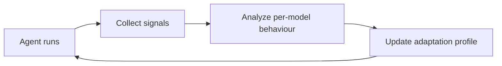

# Adaptation Loop

## Purpose

The Adaptation Loop is the part of Axol that watches how a model behaves and adjusts the harness composition accordingly. It is still a planned architecture component, but the current prototype already gives it the raw data it will need: tool-call traces, approval flows, errors, model outputs, and memory usage.

## Current starting point

The repo already produces the kinds of signals the loop would consume:

- `model` responses and tool calls in `modules/agent.py`
- `tool_result` / `error` / `done` events in `mock_server.py`
- memory writes and reads in `modules/local_tools.py`
- browser-side event flows in `web/src/contract.ts`

That means the loop can be built around a standard event stream rather than needing a redesign later.

## Future design

The long-term idea is:

The adaptation profile would eventually help tune:

- prompt style
- tool selection strategy
- context handling
- approval and safety policies
- behavioral constraints for a given model

## Depends on / used by

- Depends on: [Experience Store](Experience%20Store.md), [Evaluation](Evaluation.md)
- Used by: [Harness Forge](Harness%20Forge.md)

## Related decisions

- [ADR-0002](../Decisions/ADR-0002-plugin-kernel-runtime.md)

## Open questions

- [ ] what exactly should be the signal schema
- [ ] whether adaptation is online or offline
- [ ] how to compare model behavior before/after harness changes
- [ ] how much of the loop should be automated vs. human-reviewed

Back to [Overview](Overview.md)
