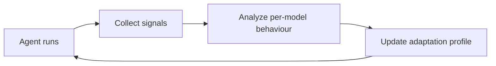

# Adaptation Loop

## Purpose
Part of the [Harness Forge](Harness%20Forge.md). Watches how the current model behaves (via [Experience Store](Experience%20Store.md) signals and [Evaluation](Evaluation.md) scores) and adjusts the harness composition: prompt format, tool-use style, context handling and control flow, so Axol does not depend on hand-tuning per model.

## Interface
```python
# TODO: sketch the public API
```

## Diagram


## Depends on / used by
- Depends on: [Experience Store](Experience%20Store.md), [Evaluation](Evaluation.md)
- Used by: [Harness Forge](Harness%20Forge.md)

## Related decisions
-

## Open questions
- [ ]

Back to [Overview](Overview.md)
