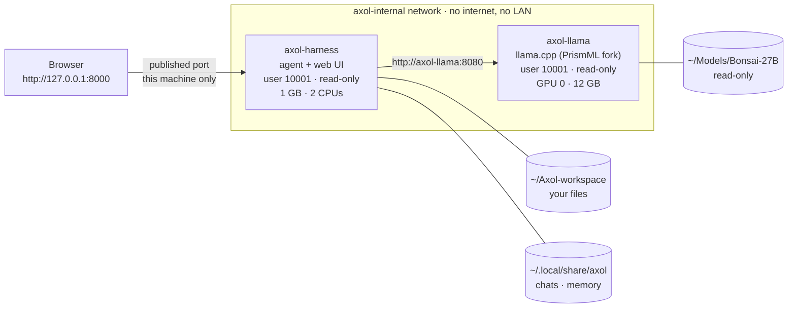

# Running Axol in containers: how and why

> [!note] In short
> Axol runs as two locked boxes: **the model** (llama.cpp on the GPU) and **the harness** (the agent and its web UI). Neither can reach the internet. Neither runs as root. Neither can change its own files. Your data lives outside both, so a box can be thrown away and rebuilt without losing anything.
> This is project 1 of [Secure Axol](Secure%20Axol.md). The decisions are recorded in [ADR-0005](../Decisions/ADR-0005-containers.md), and what we defend against is in the [Threat Model](Threat%20Model.md).

## The picture



| Piece | Where it's defined | What it is |
|---|---|---|
| `axol-llama` | [`deploy/llama/Containerfile`](../../deploy/llama/Containerfile) | the model server: the PrismML llama.cpp fork compiled for this GPU |
| `axol-harness` | [`deploy/harness/Containerfile`](../../deploy/harness/Containerfile) | `mock_server.py`, `modules/`, built-in plugins, and the built UI |
| both together | [`compose.yaml`](../../compose.yaml) | networks, folders, limits, health checks |
| what goes into a build | [`.containerignore`](../../.containerignore) | deny by default: only the files listed |

## Quick start

**Once per machine:**
1. **Rootless Podman** and `podman-compose`. On Ubuntu: `sudo apt install podman podman-compose`. Rootless is the default.
2. **NVIDIA Container Toolkit**, from NVIDIA's apt repository. On recent versions the GPU description (CDI) is generated and refreshed automatically. Check it with `nvidia-ctk cdi list`.
3. **Pin Podman's storage**, if you ever run Podman from an editor installed as a snap (VSCodium, VS Code snap). Put this in `~/.config/containers/storage.conf`, with your own user name and number:
   ```toml
   [storage]
   driver = "overlay"
   graphroot = "/home/<you>/.local/share/containers/storage"
   runroot = "/run/user/<uid>/containers"
   ```
   The reason is in **Troubleshooting** below.
4. **Create the two data folders:** `mkdir -p ~/Axol-workspace ~/.local/share/axol`
5. **Get the model:** `~/Models/Bonsai-27B/Ternary-Bonsai-2-27B-PQ2_0.gguf` (`hf download prism-ml/Ternary-Bonsai-2-27B-gguf …`).

**Every day**, from the repo root:

| Command | Does |
|---|---|
| `podman-compose up -d` | start Axol, then open **http://127.0.0.1:8000** |
| `podman-compose ps` | what's running, and whether it's `(healthy)` |
| `podman-compose logs -f` | follow both logs |
| `podman-compose down` | stop and remove the containers. Your data stays |
| `podman-compose up -d --build` | rebuild the images after changing code. The first model build downloads ~5.6 GB of CUDA images and compiles for ~6 minutes |

After `up`, the UI says *"Waking the model…"* for a few seconds, then you can chat. Both containers usually report healthy in about 15 seconds.

**Developing** stays as before: llama.cpp, `uvicorn --reload` and `npm run dev` in three terminals (see the README). Containers are how Axol *runs*, not how you edit it.

---

## Why each part is the way it is

### 1. Rootless Podman, and no `docker` or `lxd` group
A container is a normal Linux process with a blindfold on. What matters is **who that process really is**. Classic Docker starts containers from a root service, so an escape means root on the laptop. **Rootless** Podman starts them as you, so an escape lands as a normal user.

Users inside a container are mapped onto spare user IDs (`/etc/subuid`, e.g. `100000–165535`). Container user 10001 becomes host user 110000, which **owns nothing**. Membership of the `docker` or `lxd` group is root without a password, because it can ask a root service to mount `/`. That undoes all of the above, so neither group is used.

### 2. Everything from outside is pinned
| Thing | Pinned by | Why |
|---|---|---|
| Base images | digest, `@sha256:…` | a tag is a label the publisher can move. A digest is a fingerprint of the contents. Podman's default policy accepts any image (`insecureAcceptAnything`), so the digest is the check |
| The fork's source | tag **and** commit; the build stops if `git rev-parse HEAD` differs | a git tag can be moved too |
| Python and npm packages | exact versions (`requirements.txt`, `package-lock.json` with `npm ci`) | the same code on every machine and every build |
| The MCP `time` server | installed at build time, pinned | before, `uvx` downloaded it at every start: unpinned code, and internet needed at start-up |

### 3. Small images: multi-stage builds and deny-by-default context
Each image is built in two stages. A throwaway stage has the compilers (Node, the CUDA toolkit). The final stage receives **only the result**: `web/dist` (1.7 MB, not 210 MB of `node_modules`), and one static `llama-server` (not ~9 GB of CUDA toolkit). Everything in an image is code you trust, so less is safer.

`.containerignore` starts with `*` (nothing) and lets back in only what's needed. So `memory.md`, `sessions/`, `workspace/`, `.env`, `.venv` and `.git` can't end up in an image, including files nobody has created yet. The build context shrank from 330 MB to 652 KB.

### 4. Non-root users with fixed numbers
Both images create a plain user, **10001:10001** (`axol` and `llama`), with no password, home or shell, and run as it. The fixed numbers matter in §6.

### 5. Settings from outside (`AXOL_*`, `LLAMA_ARG_*`)
`localhost` inside a container means the container itself. So nothing about *where* Axol runs is written in code:

| Harness setting | Default (dev) | In compose |
|---|---|---|
| `AXOL_LLAMA_URL` | `http://localhost:8080/v1` | `http://axol-llama:8080/v1` (the service name) |
| `AXOL_OLLAMA_URL` | `http://localhost:11434/v1`; empty = off | empty (off) |
| `AXOL_DATA_DIR` | repo root | `/data` |
| `AXOL_WORKSPACE_DIR` | repo `workspace/` | `/workspace` |
| `AXOL_MCP_CONFIG` | repo `mcp_server.json` | the container's own file: `time` only, so **no `fetch`** |
| `AXOL_ALLOWED_ORIGINS` | the UI's local addresses | `http://127.0.0.1:8000`, `http://localhost:8000` |

llama-server reads `LLAMA_ARG_*` the same way (model file, layers, context), so the model image doesn't care which model it runs.

### 6. Your data on the host, mapped to you
Containers are disposable, so nothing important lives inside them:
- `~/Axol-workspace` → `/workspace`: **your files**, visible. Never the Desktop or the repo, because the agent can write and delete there.
- `~/.local/share/axol` → `/data`: **Axol's state**, chats (`sessions/*.jsonl`) and `memory.md`.
- `~/Models/Bonsai-27B` → `/models`, **read-only**.

`userns_mode: keep-id:uid=10001,gid=10001` maps the harness user onto *you*, so its files belong to `lenos` on the host. Without it, writes fail, because user 110000 isn't allowed in your folders. The model container doesn't get this: it only reads, and staying a stranger to your files is safer.

### 7. One internal network, and one published port
- The network `axol-internal` is `internal: true`: **no route to the internet or the LAN**. The harness finds the model by its name, `axol-llama`.
- The harness's port is published on **`127.0.0.1` only**. Other machines get "connection refused".
- A published port still works on an internal network, so the harness doesn't need internet access either. The agent therefore can't fetch web pages until job sandboxes (project 3) give that power to a separate, file-less job.

### 8. Hardening: what a broken or hijacked container can still do
| Setting (both containers) | Effect |
|---|---|
| `read_only: true` + `tmpfs: /tmp (64 MB)` | it can't change its own programs. It writes only to `/tmp` and its mounted folders |
| `cap_drop: [ALL]` | no special kernel powers (`CapEff: 0000000000000000`) |
| `security_opt: [no-new-privileges]` | nothing inside can gain more rights later (`NoNewPrivs: 1`) |
| `mem_limit` (1 GB / 12 GB), `cpus: 2` (harness), `pids_limit` (128 / 256) | a runaway loop or fork bomb can't freeze the laptop |

### 9. Only Axol's own page may open the WebSocket
Browsers let any website open a WebSocket to `localhost`, so a page you had open could have driven the agent. The harness checks the `Origin` header against `AXOL_ALLOWED_ORIGINS` and refuses everything else with HTTP 403 ([`modules/origins.py`](../../modules/origins.py)). Containers alone don't fix this, because the browser runs on the same machine.

### 10. Health and readiness
- **Liveness:** "is the process up?" The harness answers `GET /health` → `{"ok": true}`. llama.cpp answers `/health` too, and its image has no curl, so compose checks it with plain bash (`/dev/tcp`).
- **Readiness:** "can the model answer yet?" The harness asks llama's `/health` every 2 s and sends a `model_status` event (`loading` / `ready` / `unreachable`). The UI shows *"Waking the model…"* and holds Send until it's ready. The desktop app's loading screen (project 7) will use the same signal.

### 11. The model server is stripped down
The fork is compiled as one static binary, for this GPU only (`sm_120a`), **without an HTTPS client**, so it can't download models even if asked. It also has **no built-in chat page**: Axol has its own, and the build would otherwise download one from the internet.

---

## Proven (2026-11-25)

| Check | Result |
|---|---|
| Model container reaches the internet | ❌ blocked |
| Harness reaches the internet | ❌ blocked (`URLError`) |
| Harness sees the host's files | only `/data` and `/workspace`. `/home` is empty |
| Port from another device (`192.168.x.x:8000`) | refused. Works on `127.0.0.1` only |
| Secrets or data inside the images | 0 files |
| Users / root filesystem / capabilities | 10001 / read-only / none, `NoNewPrivs: 1` |
| A real chat, then `down` + `up` | memory and chats survive; asked again, Axol remembers |
| Files on the host | owned by `lenos` |
| Speed in the hardened container | **37.4 tok/s** (bare metal: 36.6) |
| Health | both `(healthy)` ~15 s after `up` |

## Troubleshooting (things we actually hit)

| Symptom | Cause | Fix |
|---|---|---|
| `cudaMalloc failed: out of memory` while loading | llama.cpp prepares 4 parallel slots by default, each with its own cache | `-np 1` / `LLAMA_ARG_N_PARALLEL=1`, plus flash attention |
| A CUDA image runs `nvidia-smi` but llama fails with "driver insufficient" | the image's CUDA is newer than the driver supports (`nvidia-smi` shows the maximum) | use a CUDA version ≤ the host's. `nvidia-smi` passes either way, because it comes from the host |
| Status stuck at `(starting)`. Health timers fail with *"no such container"* | an editor installed as a snap changes `XDG_DATA_HOME`, so Podman uses a different storage folder than systemd | pin `graphroot` in `~/.config/containers/storage.conf` (Quick start, step 3) |
| `--userns and --pod cannot be set together` | podman-compose puts services in a pod by default | `x-podman: in_pod: false` at the top of `compose.yaml` |
| `podman exec` says *"unable to find user axol"* | a Podman quirk with read-only containers and user names | `podman exec --user 10001:10001 …` |
| The harness can't write to `/data` | user mapping, see §6 | `userns_mode: keep-id:uid=10001,gid=10001` |
| UI shows "Not connected", log says `[ws] refused connection from origin …` | the page's address isn't in `AXOL_ALLOWED_ORIGINS` | add it, or open the UI at `http://127.0.0.1:8000` |
| Build fails on `ui-assets` / `download dist.tar.gz` | llama.cpp tries to download its chat page during the build | `-DLLAMA_USE_PREBUILT_UI=OFF` (already set) |
| A benchmark is suddenly 15% slower | the GPU's power state at that moment | measure back to back, several times, before changing anything |

## Not covered yet

- **Logins.** Anyone who can reach `127.0.0.1:8000` on this machine is "the user". That's project 2, and it's required before the port is opened to the VPN.
- **Job sandboxes.** The agent's file tools still run inside the harness, and `../` in a filename isn't blocked yet (project 2 gate, project 3).
- **Disk quotas** for `/data` and `/workspace` (project 2/3). The root filesystems are read-only, so a container can only fill its mounted folders and its 64 MB `/tmp`.
- **Starting without a terminal.** The desktop app (project 7) will start these same containers, probably as systemd user services.

Back to [Overview](Overview.md)
