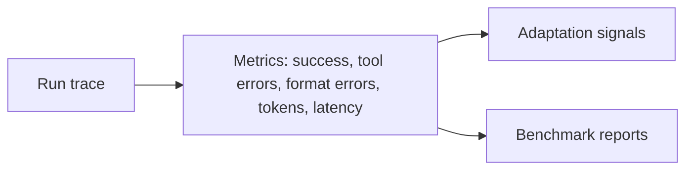

# Evaluation

## Purpose
Scores agent runs and produces the signals the [Adaptation Loop](Adaptation%20Loop.md) learns from. Also hosts benchmarks for comparing models and harness versions.

## Interface
```python
# TODO: sketch the public API
```

## Diagram


## Depends on / used by
- Depends on: [Harness](Harness.md) traces
- Used by: [Adaptation Loop](Adaptation%20Loop.md)

## Related decisions
-

## Open questions
- [ ]

Back to [Overview](Overview.md)
