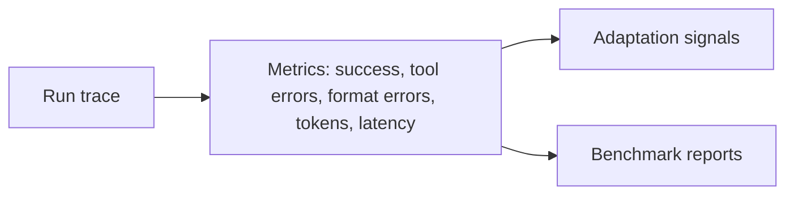

# Evaluation

## Purpose

Evaluation is how Axol scores runs, compares harness versions, and creates benchmark cases from real behavior. This is still a planned system, but the project is already producing core inputs: streamed model thinking and text, tool calls and results, and errors.

## Current starting point

The prototype already emits enough structured events to evaluate behavior:

- `thinking` and `text` events show how the agent is reasoning and responding
- `tool_call` and `tool_result` show operational correctness
- `error` captures turn failures
- `done` provides completion markers

The contract reserves `approval_request` and optional usage metadata, but the current agent path does not emit them yet. The implemented events are enough to start building metrics such as:

- success vs. failure
- tool error rate
- prompt or output format failures

## Future design

The long-term evaluation pipeline is:

The purpose is to turn real runs into repeatable benchmark cases and adaptation signals.

## Depends on / used by

- Depends on: [Harness](Harness.md) traces
- Used by: [Adaptation Loop](Adaptation%20Loop.md), [Harness Forge](Harness%20Forge.md), [Model Forge](Model%20Forge.md)

## Related decisions

- [ADR-0003](../Decisions/ADR-0003-experience-store.md)

## Open questions

- [ ] which metrics should be considered authoritative
- [ ] how to treat approval flows in scoring
- [ ] whether benchmark cases should be human-authored or derived automatically
- [ ] how to compare model versions across different harness compositions

Back to [Overview](Overview.md)
