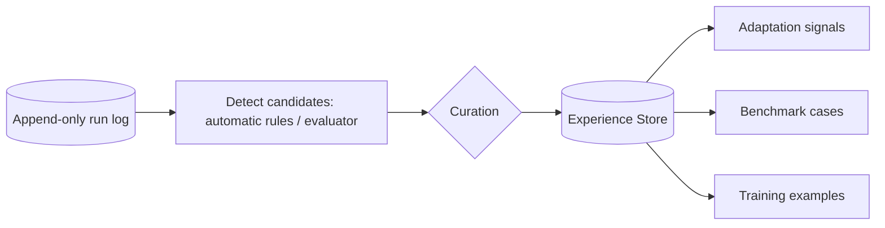

# Experience Store

## Purpose
The glue of Axol. Turns raw run logs into **curated experiences** that feed three consumers:

| Consumer | Uses experiences as |
|----------|---------------------|
| [Adaptation Loop](Adaptation%20Loop.md) / [Harness Forge](Harness%20Forge.md) | signals about how a model behaves in a harness |
| [Evaluation](Evaluation.md) | **benchmark cases**: problems turned into repeatable tests |
| [Model Forge](Model%20Forge.md) | **training examples** for future fine-tuning |

Axol is private, so full trajectories are recorded by design.

## Kinds of experience
- **Problem**: tool-call errors, malformed output, loops, context overflow, wrong answers, plus the fix that worked (if any).
- **Success**: good solutions worth imitating.
- **Correction**: a failure followed by the corrected trajectory (most valuable for training).

## Diagram

## Design notes
- The **run log is the raw source of truth** (append-only, like dsh's session log). The Experience Store is a curated layer that references log entries, so nothing is lost.
- Every experience is **labelled once** (kind, model, harness version, outcome, tags) and reused by all three consumers.
- Experiences record **which model + which harness composition** produced them, so data can be filtered per model/harness generation.

## Depends on / used by
- Depends on: [Harness](Harness.md) runtime run log
- Used by: [Adaptation Loop](Adaptation%20Loop.md), [Harness Forge](Harness%20Forge.md), [Evaluation](Evaluation.md), [Model Forge](Model%20Forge.md)

## Related decisions
- [ADR-0003](../Decisions/ADR-0003-experience-store.md)

## Open questions
- [ ] **Curation: automatic, human-approved, or both?** (proposal: automatic capture + human approval before something becomes a benchmark or training example)
- [ ] Storage: SQLite + files? Parquet/JSONL for training export?
- [ ] Deduplication of similar failures
- [ ] Redaction of secrets before data becomes training material

Back to [Overview](Overview.md)
