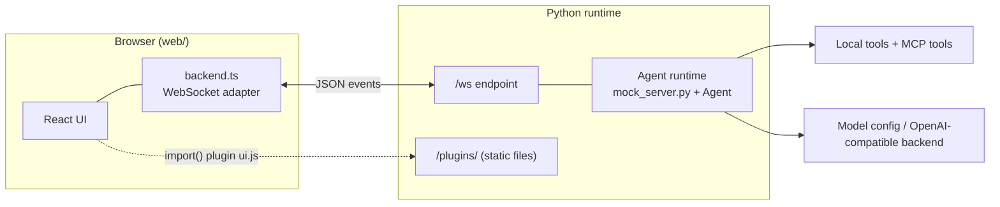
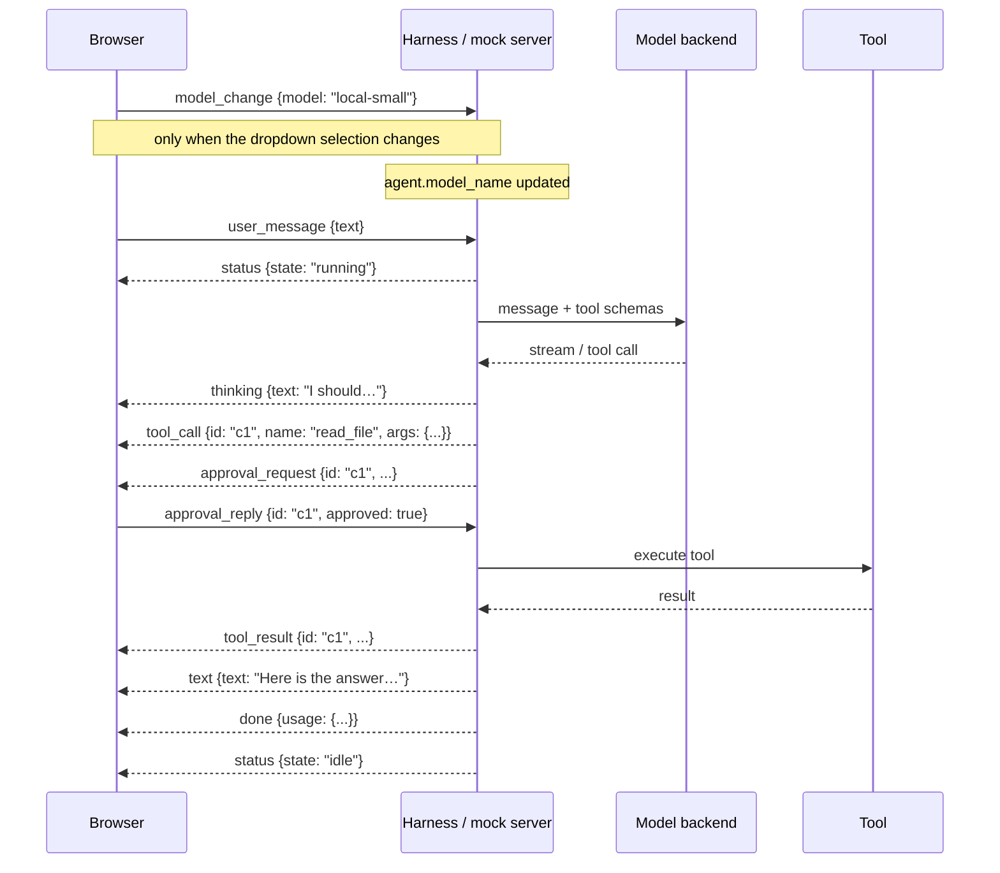

# Front end ↔ Harness: how they talk

This document reflects the implemented prototype. The browser UI in `web/` is already connected to a mock backend in `mock_server.py`, and both sides follow the event contract in `web/src/contract.ts`.

> **Source of truth:** `web/src/contract.ts`. If this note and that file disagree, the file wins.

## 1. The big picture

There is a single WebSocket (`/ws`). The browser and the Python side exchange small JSON objects with a `type` field. The UI is deliberately dumb: it does not understand the agent; it just renders the event stream.



The Python side is currently `mock_server.py`, which plays scripted scenarios while the real harness runtime is still being built. The browser cannot tell the difference between a mock and a production server because the  protocol is the real interface.

## 2. Contract shape

The contract is defined in `web/src/contract.ts` and includes both server→browser and browser→server events.

### Server → browser

| `type` | fields | purpose |
|---|---|---|
| `status` | `state` | running/idle lifecycle |
| `model_list` | `models`, `selected` | model selector state |
| `thinking` | `text` | streamed reasoning block |
| `text` | `text` | streamed answer content |
| `tool_call` | `id`, `name`, `args` | tool card starts |
| `tool_result` | `id`, `name`, `result`, `is_error` | tool card resolves |
| `approval_request` | `id`, `tool`, `args`, `reason` | user approval request |
| `done` | `usage?` | turn completion |
| `error` | `message` | fatal turn error |
| `operation_result` | `request_id`, `ok`, `result?`, `error?` | response to UI operation |
| `plugin_loaded` | `name`, `ui_url` | plugin activation |
| `plugin_unloaded` | `name` | plugin teardown |

### Browser → server

| `type` | fields | purpose |
|---|---|---|
| `user_message` | `text` | send a user prompt |
| `model_change` | `model` | switch the active model |
| `approval_reply` | `id`, `approved` | approve or deny a tool action |
| `cancel` | — | cancel running turn |
| `call_operation` | `request_id`, `name`, `args` | request a UI/server operation |
| `plugin_error` | `name`, `slot`, `error` | plugin crash report |

`model` on `model_change` is a registry key (`local`, `local-small`), the same `name` the server put in `model_list`. It is not the display label.

The dropdown sends `model_change` only when the selection changes. A later `user_message` does not repeat the model. The server stores the choice on `agent.model_name`, and the next turn reads that field when it opens the model client. Picking the model that is already active is a no-op. An unknown name is ignored.

## 3. Example turn flow



The real harness should follow this same lifecycle. The mock server already demonstrates the exact pattern for `thinking`, `tool_call`, `tool_result`, `approval_request`, `error`, `cancel`, and `done`.

## 4. Rules the harness must keep

1. `status: running` must be sent at the beginning of each turn and `status: idle` at the end, even on error or cancel.
2. Every turn ends with `done` or `error`.
3. Every `tool_call` gets exactly one `tool_result` with the same `id`.
4. `approval_request.id` must match the same tool call's `id`.
5. `thinking` and `text` are incremental deltas, not whole-message rewrites.
6. Only one turn can run per WebSocket connection at a time.
7. `plugin_loaded.ui_url` must live under `/plugins/` on the same origin.
8. Long-running work must not block the socket loop; user actions like `cancel`, `approval_reply`, and `model_change` must still be processed.
9. The active model changes only through `model_change`. `user_message` carries the prompt text and nothing else.

## 5. How it matches the code today

The current implementation already includes the important parts:

- `mock_server.py` creates `Turn` objects and streams scenario events as the harness would
- `modules/agent.py` manages model calls and tool dispatch
- `modules/local_tools.py` and `modules/mcp_tools.py` define the actual tool providers
- `web/src/contract.ts` enforces runtime validation for every browser/server event

This is the prototype contract the real server should aim to satisfy.

## 6. Try it yourself

```bash
# terminal 1: fake harness
.venv/bin/uvicorn mock_server:app --port 8000 --reload

# terminal 2: UI
cd web && npm run dev
```

Then open `http://localhost:5173` and use `/scenario` commands like `basic`, `tools`, `approval`, `error`, `cancel`, `plugin`, `plugin_crash`, and `plugin_healthy`.

Back to [Overview](Overview.md)
