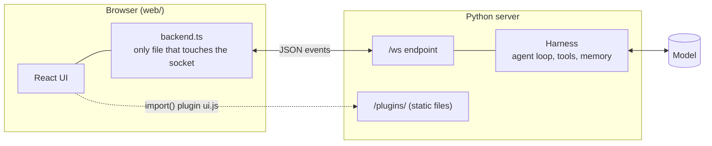
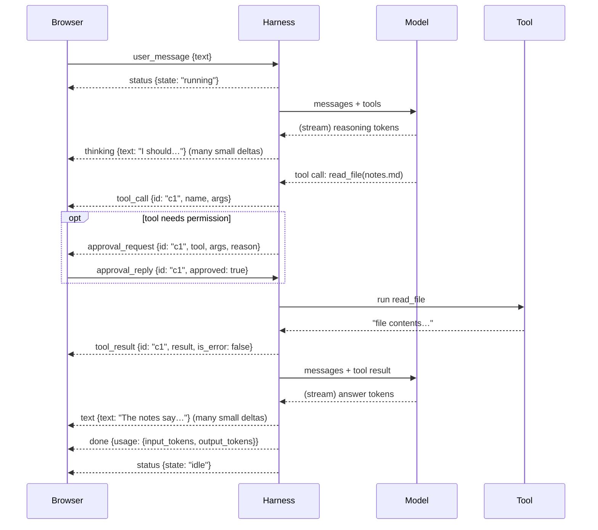

# Front end ↔ Harness: how they talk

A short guide to keep in mind while we build the harness. The UI already exists (`web/`) and runs against a fake back end (`mock_server.py`). Our job is to build the **real harness so that it sends the same events**. The UI will then work with it unchanged.

> **Source of truth:** `web/src/contract.ts`. If this note and that file disagree, the file wins.

## 1. The big picture

There is **one WebSocket** (`/ws`). Both sides send small **JSON objects**, and each one has a `type` field. That's the whole protocol.



Today the Python side is `mock_server.py`, which plays back scripted scenarios. Later it will be the real harness. **The browser can't tell the difference**, and that's the point.

## 2. The mental model: the harness *narrates*, the UI *draws*

The UI has **no logic about agents**. It doesn't know what a model is. It listens to the harness describing what it's doing ("I'm thinking…", "I'm calling `read_file`…", "here's the result…") and draws it.

So when you write the harness, ask yourself one question at every step: **"What would the user want to see right now?"** Then `emit` that event.

The two sides have four kinds of conversation:

| Conversation | Shape | Example |
|---|---|---|
| **Chat turn** | user sends 1 message → harness streams many events | `user_message` → `thinking`… `text`… `done` |
| **Approval** | harness asks a question and **waits** for the answer | `approval_request` → `approval_reply` |
| **Operation** | UI asks for data, harness answers once | `call_operation("memory.read")` → `operation_result` |
| **Plugin** | harness tells the UI to load extra UI code | `plugin_loaded` → browser imports `/plugins/x/ui.js` |

## 3. One turn, end to end

This is the main flow. Each arrow is one JSON event.



### The same thing, as harness code

This is the cheat sheet. It's a sketch of the agent loop with the `emit` calls in the right places, not real code yet:

```python
async def run_turn(user_text):
    await emit({"type": "status", "state": "running"})           # 1. always first
    try:
        messages.append({"role": "user", "content": user_text})
        while True:                                                # one step per loop
            reply = await model.stream(messages, tools)
            async for delta in reply:
                if delta.reasoning: await emit({"type": "thinking", "text": delta.reasoning})
                if delta.content:   await emit({"type": "text",     "text": delta.content})

            if not reply.tool_calls:                               # nothing owed → turn over
                await emit({"type": "done", "usage": reply.usage})
                return

            for call in reply.tool_calls:
                await emit({"type": "tool_call", "id": call.id, "name": call.name, "args": call.args})
                if needs_approval(call):
                    ok = await ask_user(call)                      # sends approval_request, waits
                    if not ok:
                        await emit({"type": "tool_result", "id": call.id, "name": call.name,
                                    "result": "user denied this action", "is_error": True})
                        continue
                result, is_error = await run_tool(call)
                await emit({"type": "tool_result", "id": call.id, "name": call.name,
                            "result": result, "is_error": is_error})
                messages.append(tool_message(call, result))
    except CancelledError:
        await emit({"type": "done"})                               # user pressed Stop
    except Exception as e:
        await emit({"type": "error", "message": str(e)})
    finally:
        await emit({"type": "status", "state": "idle"})            # 2. always last
```

`mock_server.py` already has a working `run_turn`, `ask()` and cancel handling. Copy its structure when we build the real one.

## 4. All the events

**Harness → Browser**

| `type` | fields | the UI… |
|---|---|---|
| `status` | `state: "idle" \| "running"` | disables/enables the composer, shows Stop |
| `thinking` | `text` | appends to the muted, collapsible "Thinking…" block |
| `text` | `text` | appends to the answer (rendered as markdown) |
| `tool_call` | `id, name, args` | shows a tool card with a spinner |
| `tool_result` | `id, name, result, is_error` | fills **the card with the same `id`** (red if error) |
| `approval_request` | `id, tool, args, reason` | opens the Allow / Deny dialog |
| `done` | `usage?` | closes the turn, shows token counts |
| `error` | `message` | closes the turn with an error |
| `operation_result` | `request_id, ok, result?, error?` | resolves the matching `callOperation` promise |
| `plugin_loaded` | `name, ui_url` | imports that JS file, calls its `activate()` |
| `plugin_unloaded` | `name` | removes everything that plugin added |

**Browser → Harness**

| `type` | fields | the harness should… |
|---|---|---|
| `user_message` | `text` | start a turn (ignore it if one is already running) |
| `approval_reply` | `id, approved` | resolve the waiting `ask_user` |
| `cancel` | — | cancel the running turn task |
| `call_operation` | `request_id, name, args` | run the operation, answer with `operation_result` |
| `plugin_error` | `name, slot, error` | log it (a plugin crashed in the browser) |

**Operations the UI already calls:** `memory.read` (string), `tools.list` (list of `{name, description, origin}`), `plugins.list`, `plugins.load`, `plugins.unload`.

## 5. Rules the harness must keep

The UI is forgiving: a bad event is logged and dropped, and the UI won't crash. Even so, break these rules and the screen will be wrong:

1. **`status: running` first and `status: idle` last, every turn**, even on error or cancel. Use `finally`.
2. **Every turn ends with `done` or `error`.**
3. **Every `tool_call` gets exactly one `tool_result` with the same `id`.** A denied approval still sends a `tool_result` (with `is_error: true`).
4. **`approval_request.id` = the tool call's `id`**, sent *after* the `tool_call`. That's how the UI knows which card is waiting.
5. **`thinking` and `text` are deltas**: send only the new piece and never the whole text so far.
6. **One turn at a time** per connection.
7. **Answer every `call_operation`** with its `request_id` within **10 s**, or the UI gives up. Answer `ok: false` with an `error` instead of staying silent.
8. **`plugin_loaded.ui_url` must start with `/plugins/`** on the same server. The UI refuses anything else, because plugin code runs with full page access.
9. **Never block the socket read loop.** Run the turn as a task, so `cancel` and `approval_reply` can still arrive while it runs.

## 6. Try it yourself

```bash
# terminal 1: the fake harness (from the repo root)
.venv/bin/uvicorn mock_server:app --port 8000 --reload

# terminal 2: the UI
cd web && npm run dev          # open http://localhost:5173
```

Type `/scenario <name>` in the chat to play one of these: `basic`, `tools`, `approval`, `error`, `long`, `cancel`, `xss`, `malformed`, `plugin`, `unplug`, `plugin_crash`, `plugin_healthy`.

To **watch the raw events**, open the browser console and run:

```js
harnessDebug.getEventLog(20)   // last 20 events, both directions
harnessDebug.getState()        // what the UI currently believes
harnessDebug.selfTest()        // runs the UI's built-in checks
```

> **Tip:** the mock scenarios are a ready-made **spec for the real harness**. When the real harness can produce the same event sequence as `tools`, `approval`, `error` and `cancel`, it's wired correctly.

## 7. How this fits the Axol architecture

The UI is a **client of the [Harness Runtime](Harness.md)**. The UI events are basically a *live view of the run log*: every `tool_call` / `tool_result` / `text` we show the user is also something we want to record for the [Experience Store](Experience%20Store.md). One option is a single internal event stream that both the WebSocket and the run log subscribe to. That's an open question below.

## Open questions
- [ ] Should the WebSocket adapter be a plugin that subscribes to the kernel's event stream (same stream as the run log)?
- [ ] The link between `approval_request` and its `tool_call` is only by convention (same `id`). Make it an explicit `tool_call_id` field?
- [ ] There is no turn id or session id, so after a reconnect the UI can't ask "what did I miss?". Do we need history replay?
- [ ] `usage` is per turn. Do we also want per-step usage for the Adaptation Loop?

Back to [Overview](Overview.md)
