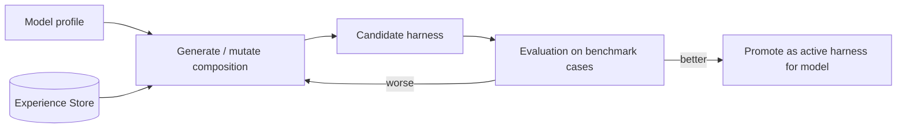

# Harness Forge

## Purpose

The Harness Forge is the part of Axol that creates and tunes harness compositions for a given model. A harness is data: an ordered set of runtime plugins plus configuration for the loop, tools, memory, and model adapter behavior. This is still a planned design, but it fits the current prototype architecture and the event-driven runtime already in the repo.

Not responsible for:

- running the agent (that is the [Harness](Harness.md) runtime)
- changing model weights (that is the [Model Forge](Model%20Forge.md))

## Concepts

- **Composition**: a declarative harness description made up of runtime pieces and config
- **Model profile**: what is known about a model (capabilities + observed behavior)
- **Candidate**: a proposed composition scored against benchmark or experience data

## Current fit with the codebase

The repo already contains the major parts the Forge will manipulate:

- model registry in `modules/models.py`
- tool registration in `modules/local_tools.py` and `modules/mcp_tools.py`
- agent loop in `modules/agent.py`
- browser/server event contract in `web/src/contract.ts`
- runtime scenario metadata in `mock_server.py`

This is exactly the surface area a future Forge would generate, mutate, and compare.

## Diagram

## Depends on / used by

- Depends on: [Experience Store](Experience%20Store.md), [Evaluation](Evaluation.md), [Adaptation Loop](Adaptation%20Loop.md)
- Used by: [Harness](Harness.md) runtime (boots the promoted composition)

## Related decisions

- [ADR-0002](../Decisions/ADR-0002-plugin-kernel-runtime.md)

## Open questions

- [ ] composition format: YAML, TOML, or code-defined objects
- [ ] how harness changes are attributed to improvements
- [ ] whether the Forge can author entirely new runtime plugins or only recombine existing ones

Back to [Overview](Overview.md)
