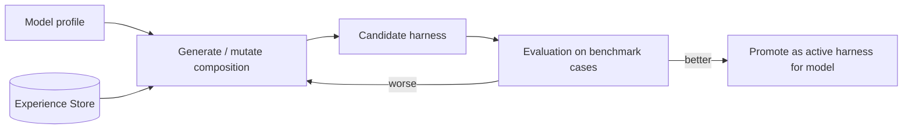

# Harness Forge

## Purpose
Creates and tunes **harness compositions** for a given model. A harness is *data*: an ordered set of runtime plugins plus their config (loop strategy, tool-call format, prompt style, context/compaction strategy, memory backend…). Because it is data, the Forge can **generate, mutate, compare and version** harnesses automatically.

Not responsible for: running agents (that's the [Harness](Harness.md) runtime) or changing model weights (that's the [Model Forge](Model%20Forge.md)).

## Concepts
- **Composition**: a declarative harness description (layers of plugin rows, overridable by patch, idea from dsh profiles/bundles/patches).
- **Model profile**: what is known about a model (capabilities from the [Model Interface Layer](Model%20Interface%20Layer.md) + observed behaviour from the [Experience Store](Experience%20Store.md)).
- **Candidate**: a proposed composition for a model, scored by [Evaluation](Evaluation.md) before it is promoted.

## Diagram

## Depends on / used by
- Depends on: [Experience Store](Experience%20Store.md), [Evaluation](Evaluation.md), [Adaptation Loop](Adaptation%20Loop.md)
- Used by: [Harness](Harness.md) runtime (boots the promoted composition)

## Related decisions
- [ADR-0002](../Decisions/ADR-0002-plugin-kernel-runtime.md)

## Open questions
- [ ] Composition format: YAML, TOML, or code-defined?
- [ ] How is a harness change attributed to an improvement (A/B on benchmarks? online?)
- [ ] Can the Forge author new plugins (like dsh "Creator" mode) or only recombine existing ones?

Back to [Overview](Overview.md)
