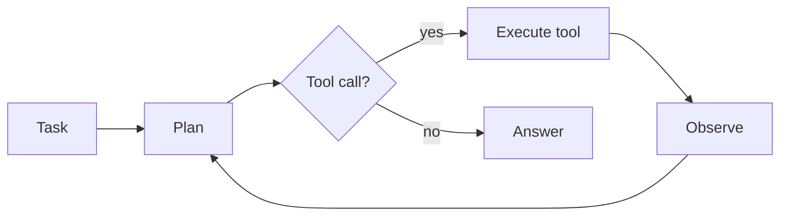

# Harness

## Purpose
The **Harness Runtime**: a plugin micro-kernel that boots a *harness composition* produced by the [Harness Forge](Harness%20Forge.md) and runs the agent. Everything is a plugin, including the agent loop, tools, memory, model adapters and context strategy. Every step is written to an **append-only run log** that feeds the [Experience Store](Experience%20Store.md). See [ADR-0002](../Decisions/ADR-0002-plugin-kernel-runtime.md).

Loop hierarchy: **step** (one model call + its tools) ⊂ **turn** (steps until nothing is owed) ⊂ **round** (outer policy: goal, retry).

## Interface
```python
# TODO: sketch the public API
```

## Diagram


## Depends on / used by
- Depends on: [Model Interface Layer](Model%20Interface%20Layer.md), [Tools](Tools.md), [Memory](Memory.md)
- Used by: [Harness Forge](Harness%20Forge.md) (supplies compositions), [Experience Store](Experience%20Store.md) (reads the run log)

## Related decisions
-

## Open questions
- [ ]

Back to [Overview](Overview.md)
