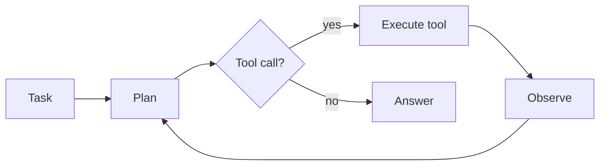

# Harness

## Purpose
Runs the agent loop: planning, tool calls, memory access and evaluation. Owns control flow and applies the current *adaptation profile* (prompting style, tool-call format, context strategy) for the active model.

## Interface
```python
# TODO: sketch the public API
```

## Diagram


## Depends on / used by
- Depends on: [Model Interface Layer](Model%20Interface%20Layer.md), [Tools](Tools.md), [Memory](Memory.md)
- Used by: [Evaluation](Evaluation.md), [Adaptation Loop](Adaptation%20Loop.md)

## Related decisions
-

## Open questions
- [ ]

Back to [Overview](Overview.md)
