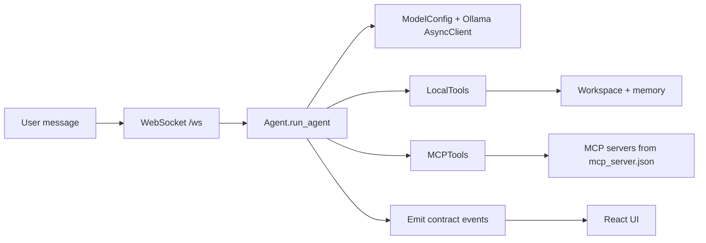

# Harness

## Purpose

The current Harness is a working prototype runtime built around an agent loop, tool execution, model config, and event streaming. It is not yet the full plugin micro-kernel described in the original design notes, but it already demonstrates the same architectural direction: a central runtime orchestrating model calls, tools, workspace context, and user interactions.

The current implementation lives primarily in:

- `mock_server.py` — FastAPI/WebSocket runtime adapter
- `modules/agent.py` — agent loop + tool routing
- `modules/local_tools.py` — workspace and memory tools
- `modules/mcp_tools.py` — MCP tool discovery and session handling
- `modules/models.py` — model configuration object

## Current runtime shape

Before it serves requests, the FastAPI `lifespan` in `mock_server.py` builds the agent and connects the MCP servers. Those sessions close when the process stops.

The flow is straightforward:

1. `mock_server.py` receives a user message.
2. A per-connection `Turn` tracks the running task, approvals, and plugin state.
3. The agent streams from Ollama with thinking enabled and yields `thinking` and `text` deltas.
4. When the model requests tools, the agent executes them, yields matching `tool_call` and `tool_result` events, and continues the model loop.
5. The mock server forwards every yielded event to the browser and wraps the turn with running/idle status.

## What exists today

### Agent loop

`modules/agent.py` already implements:

- `all_tool_schemas()` for combined local + MCP tool registration
- `call_tool()` to route synchronous or asynchronous local tools and MCP tools by name
- `run_agent()` as an async event stream that continues until no more tool calls are needed

### Runtime model layer

`modules/models.py` defines `ModelConfig` with:

- `host`
- `api_key`
- `model`

This is the current version of the model interface: an Ollama host plus the registered model name. `modules/agent.py` uses Ollama's native `AsyncClient`.

### Tool layer

The harness currently exposes two tool sources:

- `LocalTools` for workspace and memory actions
- `MCPTools` for connecting to MCP servers declared in `mcp_server.json`

Together they provide an immediate tool registry that the model can use and the agent can route against.

## Installed runtime behavior

The prototype already does the expected core actions:

- stream chat text as deltas
- stream model thinking as deltas
- emit tool calls and results
- surface errors cleanly
- handle message cancelation and plugin loading

## Remaining work

This is still not the full future runtime described in the broader design docs. The main gaps are:

- no full plugin kernel registry yet
- no append-only run log / experience store integration
- no autonomous adaptation loop
- no composition-as-data harness generation
- no full model-forge / training flow

## Depends on / used by

- Depends on: [Model Interface Layer](Model%20Interface%20Layer.md), [Tools](Tools.md), [Memory](Memory.md)
- Used by: [Front end](Front%20end.md), [Experience Store](Experience%20Store.md)

Back to [Overview](Overview.md)
