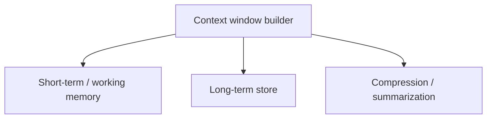

# Memory

## Purpose
Manages what the model sees: short-term context (conversation, scratchpad), long-term memory, and context compression strategies tuned per model.

## Interface
```python
# TODO: sketch the public API
```

## Diagram


## Depends on / used by
- Depends on: storage backend (TBD)
- Used by: [Harness](Harness.md)

## Related decisions
-

## Open questions
- [ ]

Back to [Overview](Overview.md)
