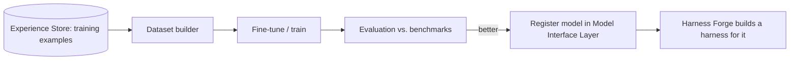

# Model Forge

> **Planned later.** The current repo is a working runtime prototype; custom model creation is a future extension.

## Purpose

The Model Forge is the long-term layer that creates or fine-tunes models specifically for the Axol harness, using examples produced from real runs and benchmark cases. This is not implemented yet, but the architecture is designed so it can be added without reworking the rest of the stack.

## Future data flow

## What must be true later

- run logs retain enough detail to reconstruct exact model-visible inputs and outputs
- training examples stay model-agnostic and include messages, tool calls, and labels
- benchmarks are versioned so model generations remain comparable

## Depends on / used by

- Depends on: [Experience Store](Experience%20Store.md), [Evaluation](Evaluation.md)
- Used by: [Model Interface Layer](Model%20Interface%20Layer.md), [Harness Forge](Harness%20Forge.md)

## Open questions

- [ ] fine-tune methods first (LoRA / QLoRA on local models?)
- [ ] hardware and budget assumptions
- [ ] dataset format standard (chat JSONL with tool calls, etc.)

Back to [Overview](Overview.md)
