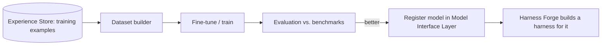

# Model Forge

> **In scope, implemented later.** Other components must be designed so this can plug in without rework.

## Purpose
Creates new models and fine-tunes existing ones **for the Axol harness**, using training examples curated in the [Experience Store](Experience%20Store.md). Long-term goal: a custom Axol model.

## Diagram

## What must be true *now* so this works later
- Run logs keep enough detail to rebuild exact model inputs/outputs ("model-visible means logged").
- Training examples are stored in a model-agnostic format (messages + tool calls + outcome + label).
- Benchmarks are versioned so model generations are comparable.

## Depends on / used by
- Depends on: [Experience Store](Experience%20Store.md), [Evaluation](Evaluation.md)
- Used by: [Model Interface Layer](Model%20Interface%20Layer.md) (new backends), [Harness Forge](Harness%20Forge.md)

## Open questions
- [ ] Fine-tune methods first (LoRA/QLoRA on local models?)
- [ ] Hardware / budget assumptions
- [ ] Dataset format standard (e.g. chat JSONL with tool calls)

Back to [Overview](Overview.md)
