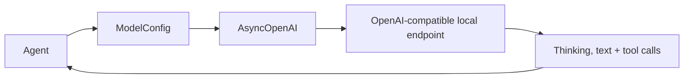

# Model Interface Layer

## Purpose

The current model interface uses the OpenAI-compatible API through `AsyncOpenAI`. This lets the same agent loop stream from different local model servers, including llama.cpp and Ollama, as long as they expose an OpenAI-compatible `/v1` endpoint.

## Current implementation

The interface is defined in `modules/models.py` as `ModelConfig`:

```python
class ModelConfig(BaseModel):
    host: str
    api_key: str = "none"
    model: str
```

This is then used by `modules/agent.py`:

```python
cfg = self.models[self.model_name]
client = AsyncOpenAI(base_url=cfg.host, api_key=cfg.api_key)
stream = await client.chat.completions.create(
    model=cfg.model,
    messages=self.messages,
    tools=self.all_tool_schemas(),
    stream=True,
    reasoning_effort="xhigh",
)
```

`run_agent()` consumes this stream directly. It emits `thinking` and `text` deltas as they arrive, reconstructs streamed tool calls, executes them, adds their results to the conversation in OpenAI format, and continues until the model returns without another tool call.

Reasoning fields are not uniform across compatible servers. The adapter accepts both fields currently observed in the supported local backends:

- `reasoning_content` from llama.cpp
- `reasoning` from Ollama's OpenAI-compatible endpoint

Either field is normalized into the frontend's `thinking` event.

## What it supports

- OpenAI-compatible local endpoints, including llama.cpp and Ollama
- streamed reasoning and answer text
- tool-aware LLM calls using function-calling schemas
- model selection via a simple registry (`self.models`)

The browser does not send the model with each prompt. On connect the server sends `model_list`. Choosing another entry in the composer sends `model_change` with the registry key, and `mock_server.py` writes that key to `agent.model_name`. The next turn uses it here:

```python
cfg = self.models[self.model_name]
```

The mock server currently registers models served by different local backends:

- `bonsai-2:27b` through llama.cpp at `localhost:8080/v1`
- `qwen3.5:4b` and `qwen3.5:2b` through Ollama at `localhost:11434/v1`

## Runtime flow



The current design is deliberately thin and composable: the harness asks for a model by name and the registry returns the endpoint + credentials + model identifier.

## Status

This is the working prototype model abstraction. The broader design still plans for additional capabilities like richer backend metadata and adaptation-aware model selection, but the repo already contains the concrete foundation for that evolution.

Back to [Overview](Overview.md)
