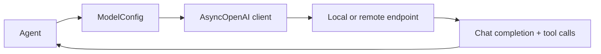

# Model Interface Layer

## Purpose

The current model interface is intentionally simple and OpenAI-compatible. It allows the runtime to switch between local and remote model endpoints without revising the rest of the agent loop.

## Current implementation

The interface is defined in `modules/models.py` as `ModelConfig`:

```python
class ModelConfig(BaseModel):
    base_url: str
    api_key: str = "none"
    model: str
```

This is then used by `modules/agent.py`:

```python
cfg = self.models[self.model_name]
client = AsyncOpenAI(base_url=cfg.base_url, api_key=cfg.api_key)
response = await client.chat.completions.create(
    model=cfg.model,
    messages=self.messages,
    tools=self.all_tool_schemas(),
)
```

This means the architecture currently targets the OpenAI-compatible API shape that local runtimes like Ollama expose via `/v1`.

## What it supports

- local OpenAI-compatible endpoints
- remote hosted model APIs with the same interface
- tool-aware LLM calls using function-calling schemas
- model selection via a simple registry (`self.models`)

The browser does not send the model with each prompt. On connect the server sends `model_list`. Choosing another entry in the composer sends `model_change` with the registry key, and `mock_server.py` writes that key to `agent.model_name`. The next turn uses it here:

```python
cfg = self.models[self.model_name]
```

The mock server binds the current prototype to local models such as:

- `local` → `qwen3.5:4b`
- `local-small` → `qwen3.5:2b`

## Runtime flow



The current design is deliberately thin and composable: the harness asks for a model by name and the registry returns the endpoint + credentials + model identifier.

## Status

This is the working prototype model abstraction. The broader design still plans for additional capabilities like richer backend metadata and adaptation-aware model selection, but the repo already contains the concrete foundation for that evolution.

Back to [Overview](Overview.md)
