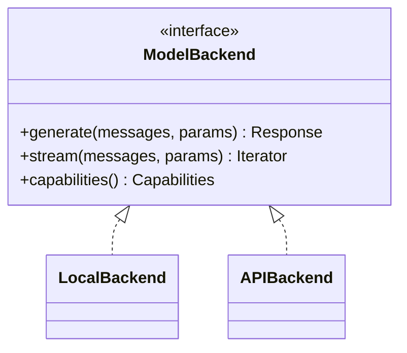

# Model Interface Layer

## Purpose
One common interface over every model backend (local and API) so the harness can swap models without code changes. Also exposes model *capabilities* (context size, native tool calling, streaming…) for the adaptation loop to use.

## Interface
```python
# TODO: sketch the public API
```

## Diagram


## Depends on / used by
- Depends on: model providers / local runtimes
- Used by: [Harness](Harness.md)

## Related decisions
-

## Open questions
- [ ]

Back to [Overview](Overview.md)
