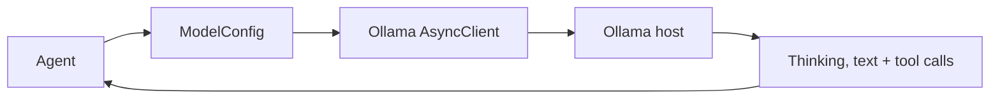

# Model Interface Layer

## Purpose

The current model interface is intentionally simple and uses Ollama's native async client. It allows the runtime to switch between models registered on an Ollama host without revising the rest of the agent loop.

## Current implementation

The interface is defined in `modules/models.py` as `ModelConfig`:

```python
class ModelConfig(BaseModel):
    host: str
    api_key: str = "none"
    model: str
```

This is then used by `modules/agent.py`:

```python
cfg = self.models[self.model_name]
client = AsyncClient(host=cfg.host)
stream = await client.chat(
    model=cfg.model,
    messages=self.messages,
    tools=self.all_tool_schemas(),
    think=True,
    stream=True,
)
```

`run_agent()` consumes this stream directly. It emits `thinking` and `text` deltas as they arrive, collects tool calls, executes them, adds their results to the conversation, and continues until the model returns without another tool call.

## What it supports

- local Ollama hosts
- streamed reasoning and answer text
- tool-aware LLM calls using function-calling schemas
- model selection via a simple registry (`self.models`)

The browser does not send the model with each prompt. On connect the server sends `model_list`. Choosing another entry in the composer sends `model_change` with the registry key, and `mock_server.py` writes that key to `agent.model_name`. The next turn uses it here:

```python
cfg = self.models[self.model_name]
```

The mock server currently registers local Ollama models such as:

- `bonsai-2:27b`
- `qwen3.5:4b`
- `qwen3.5:2b`

## Runtime flow



The current design is deliberately thin and composable: the harness asks for a model by name and the registry returns the endpoint + credentials + model identifier.

## Status

This is the working prototype model abstraction. The broader design still plans for additional capabilities like richer backend metadata and adaptation-aware model selection, but the repo already contains the concrete foundation for that evolution.

Back to [Overview](Overview.md)
