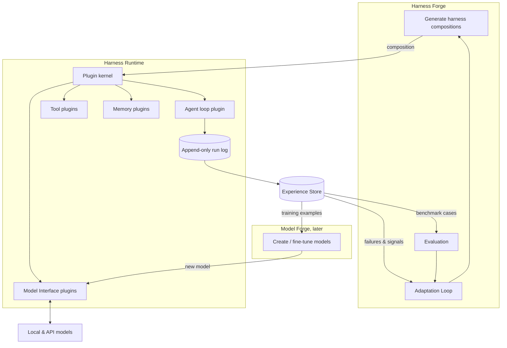
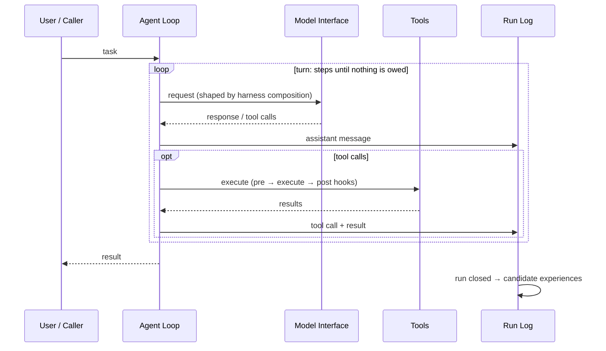

# Architecture overview

Axol is a model-agnostic agent system that **creates and adapts harnesses for models**, and later **creates and fine-tunes models for harnesses**. Everything it experiences is recorded and turned into adaptation signals, benchmarks and training data.

It is inspired by the ideas in [DeepSeek Harness](../Research/DeepSeek%20harness.md) (plugin micro-kernel, composition-as-data, append-only log) but **written from scratch with a wider scope**. See [ADR-0002](../Decisions/ADR-0002-plugin-kernel-runtime.md).

## The three layers + the glue

| Layer | Role | Note |
|-------|------|------|
| **Harness Runtime** | Runs an agent: plugin kernel, loop, tools, memory, model adapters, run log | [Harness](Harness.md) |
| **Harness Forge** | Builds and tunes harness compositions per model | [Harness Forge](Harness%20Forge.md) |
| **Model Forge** *(later)* | Creates / fine-tunes models using Axol's own data | [Model Forge](Model%20Forge.md) |
| **Experience Store** | Curated record of runs → adaptation signals, benchmarks, training data | [Experience Store](Experience%20Store.md) |

## The flywheel
1. The **Runtime** runs tasks and logs every step.
2. Notable runs (failures, fixes, good solutions) become **experiences** in the [Experience Store](Experience%20Store.md).
3. Experiences feed three consumers:
   - **Adaptation**: the [Harness Forge](Harness%20Forge.md) changes the harness for that model.
   - **Benchmarks**: failures become repeatable test cases for [Evaluation](Evaluation.md).
   - **Training data**: the [Model Forge](Model%20Forge.md) fine-tunes on them later.
4. Better harnesses/models → better runs → better data.

Axol is **private** (runs for its owners), so recording full trajectories is acceptable and intended.

## Request lifecycle (runtime)

## Components
| Component | Note | Status |
|-----------|------|--------|
| Runtime / agent loop | [Harness](Harness.md) | draft |
| Model abstraction | [Model Interface Layer](Model%20Interface%20Layer.md) | draft |
| Memory & context | [Memory](Memory.md) | draft |
| Tool system | [Tools](Tools.md) | draft |
| Harness generation | [Harness Forge](Harness%20Forge.md) | draft |
| Self-adaptation | [Adaptation Loop](Adaptation%20Loop.md) | draft |
| Evaluation & benchmarks | [Evaluation](Evaluation.md) | draft |
| Experience recording | [Experience Store](Experience%20Store.md) | draft |
| Web UI & its protocol | [Front end](Front%20end.md) | draft |
| Model creation / fine-tuning | [Model Forge](Model%20Forge.md) | later |

Visual map: [Axol.canvas](Axol.canvas) (open in Obsidian).
