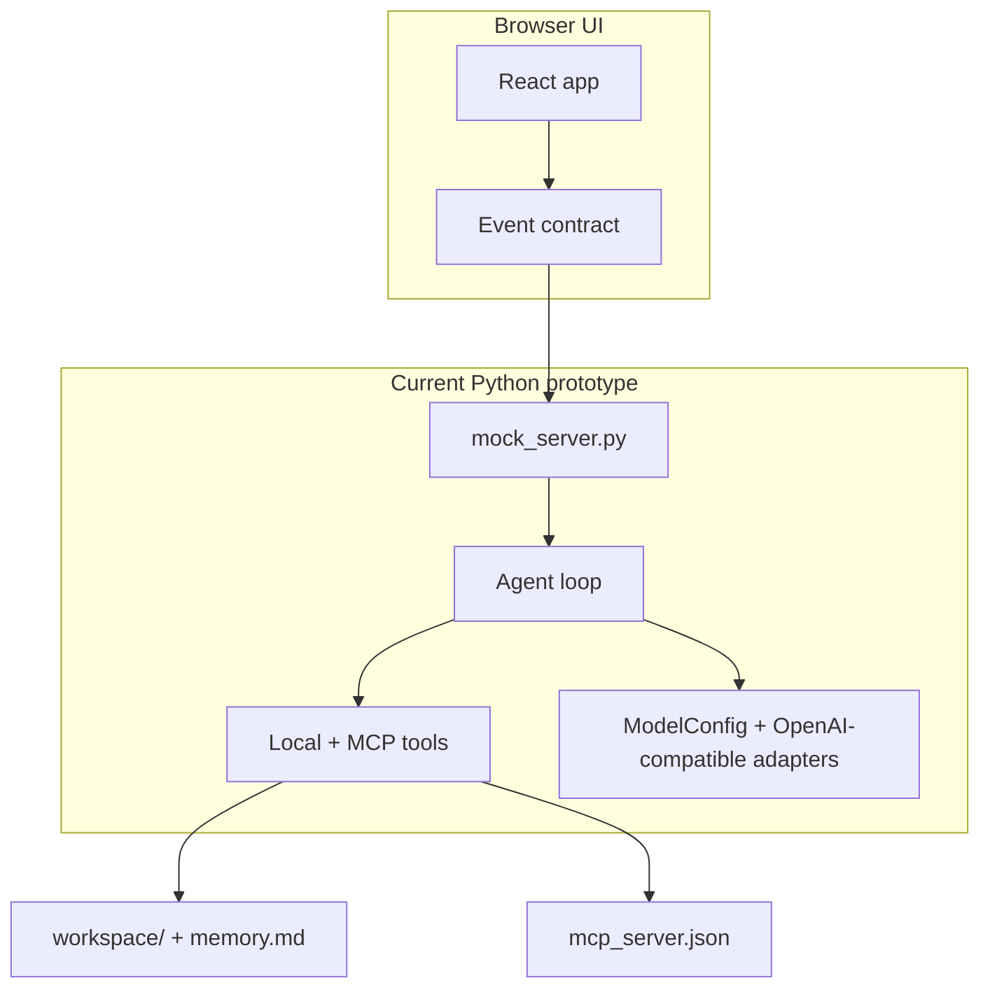
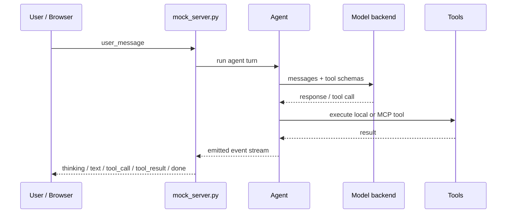

# Architecture overview

Axol is a model-agnostic agent architecture that mixes a working prototype runtime with the longer-term goal of adaptation, evaluation, and model creation. The repo already contains a live browser client, a mock harness backend, and the core Python tool/model layer that the future runtime will build on.

It is inspired by the ideas in [DeepSeek Harness](../Research/DeepSeek%20harness.md) and the plugin-kernel pattern described in [ADR-0002](../Decisions/ADR-0002-plugin-kernel-runtime.md).

## Current implementation

This is the implementation that exists today:

- browser UI + socket contract
- mock harness for scripted scenarios
- local workspace tool layer
- MCP tool discovery and execution
- simple model registry and OpenAI-compatible calls

## Three-layer roadmap

| Layer | Role | Note |
|-------|------|------|
| **Runtime / current prototype** | Runs the agent loop and tool calls | implemented as mock server + Python agent runtime |
| **Harness Forge** | Builds and tunes harness compositions per model | planned |
| **Model Forge** *(later)* | Creates / fine-tunes models from recorded experiences | later |
| **Experience Store** | Curates runs into adaptation data and benchmarks | planned |

## Request lifecycle (prototype)

## Components

| Component | Note | Status |
|-----------|------|--------|
| Runtime / agent loop | `mock_server.py` + `modules/agent.py` | prototype |
| Model abstraction | `modules/models.py` + OpenAI-compatible config | active |
| Memory & context | `modules/local_tools.py` + `memory.md` | active |
| Tool system | `modules/local_tools.py` + `modules/mcp_tools.py` | active |
| Web UI & protocol | `web/` + `web/src/contract.ts` | active |
| Harness generation | [Harness Forge](Harness%20Forge.md) | planned |
| Self-adaptation | [Adaptation Loop](Adaptation%20Loop.md) | planned |
| Evaluation & benchmarks | [Evaluation](Evaluation.md) | planned |
| Experience recording | [Experience Store](Experience%20Store.md) | planned |
| Model creation / fine-tuning | [Model Forge](Model%20Forge.md) | later |

Visual map: [Axol.canvas](Axol.canvas) (open in Obsidian).

## Remaining design work

The repo still contains the broader ambition to move from this prototype to a true adaptive kernel, but the implemented code already provides the foundations for that next step.

Back to [Home](../Home.md)
