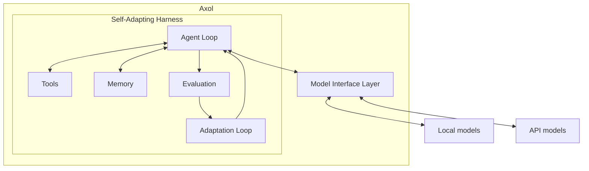
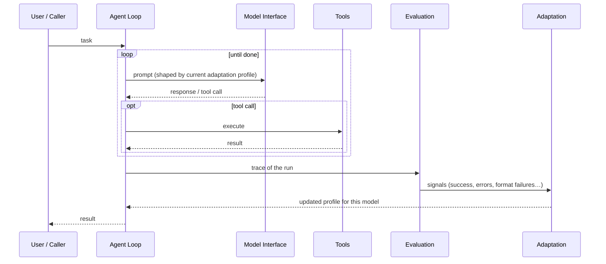

# Architecture overview

Axol is a model-agnostic agent architecture whose **harness adapts to the model**, not the other way round.

## System diagram

## Request lifecycle

## Components
| Component | Note | Status |
|-----------|------|--------|
| Agent loop / orchestration | [Harness](Harness.md) | draft |
| Model abstraction | [Model Interface Layer](Model%20Interface%20Layer.md) | draft |
| Self-adaptation | [Adaptation Loop](Adaptation%20Loop.md) | draft |
| Memory & context | [Memory](Memory.md) | draft |
| Tool system | [Tools](Tools.md) | draft |
| Evaluation & benchmarks | [Evaluation](Evaluation.md) | draft |

Visual map: [Axol.canvas](Axol.canvas) (open in Obsidian).
Inspiration: [DeepSeek harness notes](../Research/DeepSeek%20harness.md).
