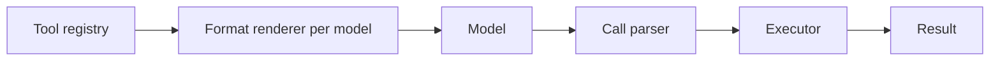

# Tools

## Purpose
Tool registry and execution. Defines tools once and renders them in whatever format the current model handles best (native function calling, JSON, XML, etc.).

## Interface
```python
# TODO: sketch the public API
```

## Diagram


## Depends on / used by
- Depends on: [Model Interface Layer](Model%20Interface%20Layer.md) capabilities
- Used by: [Harness](Harness.md)

## Related decisions
-

## Open questions
- [ ]

Back to [Overview](Overview.md)
