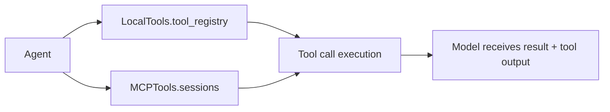

# Tools

## Purpose

The current tool system is simple but real: it combines workspace utilities with a generic MCP entry point. Tool schemas are exposed to the model and tool calls are routed through the agent runtime.

## Current implementation

The repo contains two concrete tool providers:

### 1. Local tools

`modules/local_tools.py` defines `LocalTools`, which manages:

- `list_files()`
- `read_file(filename)`
- `write_file(filename, content)`
- `delete_file(filename)`
- `save_memory(fact)`

These actions operate against the project workspace and a memory file. The class also provides:

- `tool_registry()` — callable functions by tool name
- `tool_schemas()` — OpenAI-compatible function definitions for model/tool calling

### 2. MCP tools

`modules/mcp_tools.py` defines `MCPTools`, which:

- reads `mcp_server.json`
- starts configured MCP servers via stdio
- initializes each `ClientSession`
- lists exposed tools and stores them under a session registry
- exposes `schemas()` so the model sees them alongside local tools

This gives the runtime a combined tool surface without hard-coding each external tool.

## Runtime flow

The actual agent routing is in `modules/agent.py`:

- `all_tool_schemas()` merges local and MCP tool definitions
- `call_tool()` resolves a tool name and invokes the matching local handler or MCP session
- results are appended back into the model message history

## Current contract

Tool calls are represented as OpenAI-compatible function calls with fields like:

- `name`
- `arguments` (JSON payload)
- `tool_call_id`

This is the structure the mock server and browser front end already understand.

## Design status

This is the working prototype tool layer. The long-term goal is still a richer plugin-based, composable runtime, but the repo already includes a concrete implementation that can be used for prototype development and testing.

Back to [Overview](Overview.md)
