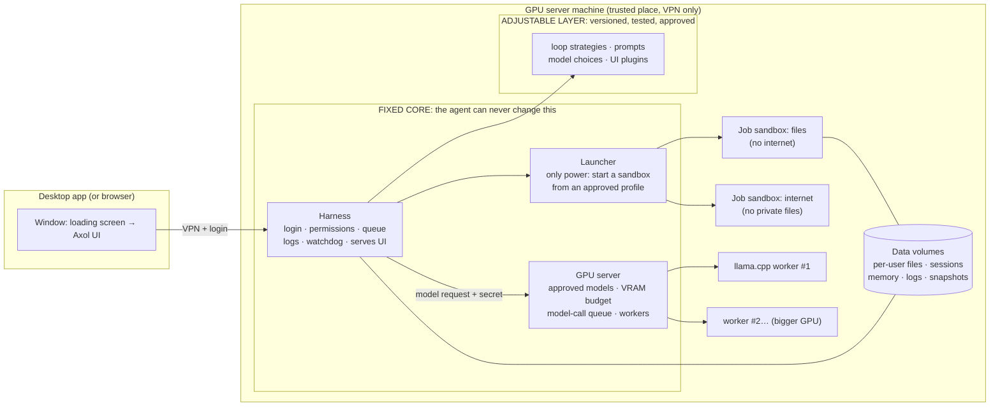

# Axol: containers, people and safe evolution (design)

> Roadmap design for making Axol **robust and safer** without losing what makes it Axol: a harness that can change its own loop, models and UI as it goes (the idea we like in the [DeepSeek harness](../../Research/DeepSeek%20harness.md), concept only, no dsh code).
>
> This document is the map. Each project gets its own teaching plan, one feature at a time.

## 1. Intent

Axol today runs as three terminal processes under Lenos's own user account: llama.cpp on `:8080`, the harness (`mock_server.py`) on `:8000`, and Vite on `:5173`. Anything the agent does, it does with full access to the home folder.

We want:

- **Safety.** The agent can only reach what the current task needs. One user's data is walled off from another's. Mistakes can be undone. Every action is logged where the agent cannot edit it.
- **Robustness.** A broken or stuck agent is noticed, falls back to something that works, or stops and reports. A broken container is thrown away and restarted from a clean image.
- **Evolution kept.** Axol may change its agent loop, switch models, benchmark them, and grow its UI. The safety rules sit in a layer that evolution can never touch.
- **A real app.** Click an icon, a window opens, the containers run hidden. Other people can use it too.

## 2. Goals, non-goals, anti-goals

**Goals**
- llama.cpp runs in its own container. The harness and the built UI run in another. All persistent data lives outside the images.
- Several people (Lenos, Stefanos, later others) log in to one GPU server over the VPN.
- Every job runs with a **permission list** that the core enforces: which folders, read or write, internet yes or no, which models.
- A job never gets **private files and the internet together** by default.
- Limits on storage, compute and time, at the container, user and job level.
- Undo, checkpoints, snapshots and append-only logs.
- A GPU server that decides which models run, swaps them, and later runs several at once.
- A watchdog that detects stuck or broken jobs and falls back or stops.
- Safe self-change: versioned, tested in a sandbox, benchmarked, approved, reversible.
- A desktop app that either connects to a server or runs everything locally.

**Non-goals (for now)**
- Kubernetes, or running across many machines. The design shouldn't block it, but we don't build it.
- Hiding data from the server owner. The server sits in a trusted place, and its owner can read its disk.
- A public website. Access is VPN only.
- Shared projects in the first people release. The data model allows them; we build them later.

**Anti-goals (it fails even if it "works")**
- The agent, or a change the agent made, can switch off its own permission checks, limits, watchdog or logs.
- One user's job can read another user's files.
- Something read from the internet becomes a standing instruction (saved to memory, or passed to a more powerful agent).
- Something from the internet can cause private data to be sent out.
- Safety relies on the model obeying a prompt instead of a rule the core enforces.
- Security that's so annoying (an approval for every write) that people click "yes" without reading.
- Starting Axol takes a terminal and commands.

## 3. Where we start (findings from the code)

| Finding | Where | Why it matters |
|---|---|---|
| `read_file` / `write_file` / `delete_file` join the filename onto the workspace with no check. `../` escapes it. | `modules/local_tools.py` | Containers limit how far the damage spreads, but the hole is still there. It gets fixed in project 3. (`workspace.read` in `mock_server.py` *does* check.) |
| `fetch` MCP server (internet) and file tools are given to the same agent. | `mcp_server.json`, `modules/agent.py` | Breaks the "never internet + files together" rule. |
| MCP servers are launched with `uvx`, which downloads packages when it starts. | `mcp_server.json` | Inside a container, that means internet access at startup plus unpinned code. Install them into the image ahead of time instead. |
| No login. Everyone shares `memory.md`, `workspace/` and all of `sessions/`. | `mock_server.py` | Needs users before anyone else connects. |
| `model_change` sets `app.state.agent.model_name` for the whole process. | `mock_server.py` (`ws_endpoint`) | One user switching models switches everyone. The model choice has to belong to the job or conversation. |
| No queue. Each connection's turn calls llama.cpp straight away. | `mock_server.py`, `modules/agent.py` | Two users fight over one 8 GB GPU with no feedback. |
| Model endpoints are hardcoded to `localhost:8080` / `:11434`. | `mock_server.py` (`MODELS`) | Inside a container, `localhost` means the container itself. Endpoints have to come from configuration. |
| FastAPI already serves `web/dist` when it exists. | `mock_server.py` | The UI doesn't need its own container. Build it into the harness image. |
| `/ws` accepted connections from any web page (cross-site WebSocket hijacking). **Fixed 2026-11-25**: Origin allow-list, lesson 1.2b. | `mock_server.py` | Any website you had open could drive the agent. |
| UI plugins are JS files the browser `import()`s into the main page. | `plugins/`, `web/src/plugins.ts` | A plugin the agent wrote itself would run with the user's full session. It needs a sandbox before the agent may generate UI. |
| Best local setup: prism fork + PQ2_0, all layers on GPU, 8K context, 36 tok/s. The fork loads CUDA libs from the official build. | `~/llama/RESULTS.md` | Building the llama.cpp image is the trickiest container step. |

## 4. Approaches considered

**A. Two containers, tools run inside the harness.** Simplest. But every job runs where the logins and all users' data live, so it can't meet the permission rules. *Used as the first stage only.*

**B. The harness orchestrates; each job runs in its own throwaway sandbox container.** The harness keeps logins, queue and logs, and never runs a tool itself. A small **launcher** is the only part allowed to start containers, and all it can start is a sandbox from an approved profile. Strongest isolation, and it fits several machines later. Costs more moving parts and about a second of startup per job.

**C. One long-lived tools container, jobs as sandboxed processes inside it** (bubblewrap/nsjail). Faster to start and needs no Docker control, but thinner walls between jobs, harder to learn and debug, and a worse fit for several machines.

**Chosen: B, built in stages** (Lenos). Project 1 builds A, with tool running kept separate inside the harness, so project 3 can replace it with launcher + sandboxes without a rewrite. C stays available if sandbox startup ever becomes a bottleneck.

**GPU server: our own, or an existing model swapper underneath** (llama-swap, llama-server's multi-model mode)? **Chosen: our own thin service** (Lenos agreed to the recommendation). Choosing a model per task is core to Axol, and the prism fork needs custom launch settings. It starts with one fixed model.

## 5. The shape of the system

### 5.1 Parts and what each is trusted with

| Part | Holds / can do | Network | Can it reach user files? |
|---|---|---|---|
| **Harness** (fixed core) | Logins, permission checks, job queue, append-only logs, watchdog, serves the UI. Runs the agent loop: talks to the GPU server, hands tool calls to sandboxes. **Never runs a tool itself** (from project 3 on). | Published only on the VPN interface (localhost in project 1). Internal network to GPU server and launcher. | Its own data only (accounts, logs, sessions). It reaches user files through sandboxes. |
| **Launcher** (fixed core) | The only part that controls the container engine. Accepts exactly one request: "start a sandbox with profile X, mounting folders Y, for job Z". | Internal only, harness-only. | Mounts them into sandboxes. Doesn't read them. |
| **Job sandbox** | Runs one job's tools, then is deleted. Gets only the folders on its permission list. | **Files profile:** no network at all. **Internet profile:** web only, through an egress filter that blocks the VPN, the LAN and internal Axol addresses. | Files profile: only the allowed folders. Internet profile: none. |
| **GPU server** (fixed core) | Approved model list, VRAM budget, starting/stopping llama.cpp workers, routing, model-call queue. Accepts requests only from the harness, with a secret. | Internal only. | No. Models are mounted read-only. |
| **llama.cpp worker** | Runs one model. | Internal only, **no internet**. | No. |
| **Data volumes** | Everything that must survive: per-user files, sessions, memory, logs, snapshots, model files. | n/a | n/a |

### 5.2 Rules every part follows

1. **The core enforces; the model never decides its own permissions.** Tools missing from a job's permission list don't exist for that job.
2. **Data flows one way.** Internet → (plain text the user can see) → file job is allowed. Files → internet is never allowed without explicit approval.
3. **Undo instead of nagging.** Reads and writes run freely. Nothing is truly overwritten or deleted: old versions go to history/trash. Approval is only needed for actions that can't be undone (emptying the trash, changing sharing, touching someone else's shared project, combining internet + files in a trusted project).
4. **Containers are disposable.** Nothing important lives inside a container. Images are built once and run with a read-only filesystem where possible.
5. **Least privilege everywhere.** Non-root users in images, dropped Linux capabilities, no privilege escalation, CPU/memory/process/disk limits.
6. **Logs only grow, and the agent can't write to them.**
7. **Secrets live in an env file or secret store, never in an image or in git.**

### 5.3 Extra guard rails

1. **Memory has a source.** Memory is per user. Every entry records where it came from. A job that has touched internet content can't write memory without approval, so a web page can't plant a standing instruction.
2. **Delegation only narrows.** An agent that starts a sub-agent can give it a subset of its own permissions, never more. Messages between agents are untrusted, like web content.
3. **Secret broker.** Agents and sandboxes never see real keys (GitHub, email, APIs). The core adds them to outgoing requests.
4. **Safety tests gate change.** A set of attack tests (prompt injection, "delete everything", "read another user's files") must pass before any adjustable-layer version goes live (§9).
5. **Supply chain pinned.** Base images by digest, Python/npm packages by version, MCP servers and plugins by version, model files by checksum.
6. **The core updates safely too.** Core releases are image versions with rollback, and data formats carry a version with one-step migrations.
7. **Backups off the machine.** 3-2-1: three copies, two kinds of storage, one somewhere else.
8. **Kill switch and alerts.** An admin button stops every job at once. The owner is notified when the watchdog stops a job or an approval is waiting.
9. **Logs are private.** Users see their own logs, admins see all, and old logs are deleted after a set retention time.
10. **Threat model on paper.** One page: who or what we defend against and which part stops each one. Updated at the end of every project.

## 6. Permission lists (job profiles)

Every job carries a permission list the core checks before giving out any tool. For example:

| Field | Example |
|---|---|
| owner | `lenos` |
| scope | `lenos/notes/` (later: `project:axol-docs`) |
| files | read `notes/`, write `notes/drafts/` |
| internet | off |
| models allowed | `bonsai-2:27b`, `qwen3.5:4b` |
| limits | 10 min, 50 tool calls, 200k tokens |

**Default for a mixed task** (Lenos chose): split it automatically. *"Find the llama.cpp release notes and add a summary to my notes"* becomes a researcher job (internet, no files) that returns plain text. The UI shows that text, then a file job (files, no internet) uses it. **Later:** a project the owner marks as *trusted* may combine both, with approval.

**Sharing** (later): every piece of data has an owner. Sharing gives named people a role on it (view / edit / run agent) plus restrictions. Private by default, and sharing is always deliberate. Even while it isn't built, the data model has **owner + members** from the start.

## 7. Limits, recovery and logs

**Limits**

| Level | What's limited |
|---|---|
| Container | CPU, memory, number of processes, disk |
| User | storage quota, fair share of the queue (max queued and running jobs) |
| Job | wall-clock time, tool calls, tokens |

**Recovery**

| Level | How |
|---|---|
| Job | Every file change a job makes is one checkpoint. "Undo this job" restores it in one step. |
| Container | Thrown away and recreated from its image. Data lives on volumes. |
| Data | Regular snapshots of user data volumes, so you can restore to an earlier day. |
| Harness behaviour | The *last-known-good* version of the adjustable layer is always kept (§9). |

**Logs.** Each job records who started it, its permission list, each model request and tool call with inputs and results, approvals, fallbacks, and resource use. Logs are append-only and written by the core, outside every sandbox. Admins and the job's owner can read them in the UI. Builds on the session log from [ADR-0004](../../Decisions/ADR-0004-per-conversation-sessions.md) and the [Experience Store](../../Architecture/Experience%20Store.md).

### 7.1 Jobs survive restarts

Containers forget; the host remembers. Every job has a **job record** the core keeps in the data folder (a small database such as SQLite): owner, permission list, state (`queued → running → done / failed / interrupted`), last finished step, checkpoint id.

- **Each step is logged as it happens**, not at the end of the turn, so a crash loses at most the step in flight. (Today `sessions/<id>.jsonl` is appended at the end of a turn.)
- **On start**, the harness reads the job records: queued jobs go back in the queue; running ones become *interrupted* and either resume from the last finished step or ask the owner.
- **Never repeat a side effect.** On resume, a step already in the log with its result is replayed from the log, not executed again. The log is the source of truth (the dsh idea, ADR-0004).
- Files: a job's sandbox mounts its folders from the host data folder, so files outlive the sandbox; the checkpoint taken before the job is what "undo this job" restores.

## 8. GPU server

- **Owns:** the approved model list (name → file, launch settings, VRAM cost), the VRAM budget, worker lifecycle (start, health-check, stop), routing requests to a ready worker, and a **model-call queue** with fairness between users.
- **Answers:** "ready", "wait, loading (ETA)", or "no, not allowed / doesn't fit".
- **The agent can ask for a different model mid-task.** The harness checks the job's permission list, then asks the GPU server, which decides whether to swap now or make the request wait.
- **Security:** only reachable from the harness, with a secret. Only loads models from the approved list. The agent can never make it download or load a model from a path or URL, because a malicious model file is a real attack. Model files are read-only, and only an admin adds new ones.
- **On this laptop (8 GB):** Bonsai 27B fills the GPU, so only one big model fits at a time. A swap costs several seconds of reload. The design still assumes a bigger GPU later.
- **Stages:** (1) one fixed model, (2) swapping on request, (3) several workers / several GPUs, (4) Ollama or API models as other backend types behind the same interface.

## 9. Safe evolution (keeping the dsh idea, adding guard rails)

What may change: **the adjustable layer**, meaning loop strategies, prompts, model choice per task type, context handling, and UI plugins.
What may never change: **the fixed core**, meaning login, permission lists, limits, launcher, GPU server's approved list, watchdog, logs.

How a change goes live:

1. **Proposed.** The agent or a person proposes it, and it gets a new version number.
2. **Tested in a sandbox** against copies of data, never the real files.
3. **Benchmarked.** The same tasks run on the old and new versions (or on several models). Scores: finished or not, time, tokens, user rating. Results go to the Experience Store, and the GPU server uses them to pick the model per task type. Benchmarks run at low queue priority, when the GPU is idle.
4. **Passes the safety tests** (§5.3, item 4). A version that's faster but fails one doesn't go live.
5. **Approved** by the owner (an admin, for anything system-wide).
6. **Live.** The previous version stays available as last-known-good, and rolling back takes one click.

**UI plugins the agent writes itself** run sandboxed in the browser (an isolated frame with a narrow message API, not the main page's session). They can only call what the core exposes to them. Hand-written plugins can keep today's path until then.

### 9.1 Plugins and trust levels

"Everything is a plugin" stays (ADR-0002): one registry, reversible registrations, hot swapping, composition as data. What's added is a **trust level** on every plugin, which decides who may change it and where it runs.

| Level | Examples | Who can change it | Runs |
|---|---|---|---|
| **Core** | kernel, login, permission checks, limits, logs, watchdog, launcher client | an admin, by installing a new core version | in the core |
| **Adjustable: settings** | prompts, loop-strategy settings, model per task, compositions | Axol, through §9 | in the core (it's data, not code) |
| **Adjustable: code** | a loop, tool or context strategy Axol wrote | Axol, through §9 | **out of the core**, in a sandboxed plugin host talking over a narrow message API |
| **UI** | screens, tabs | Axol-made ones through §9 | an isolated browser frame |

- **Core plugins can't be unloaded, replaced or patched at runtime.** In the composition (profiles → bundles → patches), core rows are locked. A patch from the adjustable layer that targets one is rejected and logged.
- **The permission check runs innermost**, right before a tool executes. Adjustable plugins may wrap a step (rewrite a prompt, retry, compact context), but they never run between the check and the execution.
- **Why code plugins run outside the core:** Python has no walls inside one process. A plugin loaded into the harness could replace the permission function or read any user's data. Only settings are safe in-process.
- **Backstop:** sandbox mounts and networks are enforced by the OS, and the GPU server keeps its own approved model list. A misbehaving plugin can make a job behave badly, but it can't widen that job's box.
- **Seams** keep working: for example *shell → local / sandboxed provider*. In multi-user mode the core only allows the sandboxed provider.

**What this costs** compared with an unguarded harness: changes wait for tests and approval (trusted projects can speed that up), code plugins pay a message round-trip, and sandboxes add about a second per job. **What it buys:** Axol can run unattended, serve several people and agents, and try bolder changes, because each one can be undone.

## 10. Watchdog

It sits in the fixed core, because a stuck agent can't notice that it's stuck.

- **Detects:** the same tool call repeating, no progress for N steps, a time/token/tool-call budget running out, model errors or timeouts, malformed tool calls, a worker or sandbox crashing.
- **Ladder:** (1) retry once, (2) fall back to the last-known-good model + loop, (3) stop, keep the checkpoint, and report to the user what happened, with a link to the log.

## 11. Two ways to run it

The same app works in two modes. This only works because UI, harness and model stay separate.

- **Connect to a server.** The app opens a window to a harness on the VPN. The laptop needs no Docker and no GPU.
- **Run locally.** The app starts the containers on this machine, shows a loading screen ("waking the model…") until the harness and model report ready, then shows the UI. Closing the window stops them or leaves them running, depending on a setting.

For other people, the installer checks for Docker (or Podman), GPU drivers and the container GPU toolkit, and walks them through setup.

## 12. Roadmap: projects and features

Each project ships something usable and is taught as its own step-by-step plan. Order matters: each project stands on the ones before it.

**Ongoing, every project:** the threat model (§5.3, item 10) is written at the end of project 1 and updated at the end of each project after that. Supply-chain pinning (item 5) applies from the first image.

### Project 1: Containers (detailed, next up)

What you have when it's done: `docker compose up` (later the app) starts Axol in two containers, with data that survives, the model on the GPU, and nothing running as your user.

| # | Feature | Done when |
|---|---|---|
| 1.1 | **Host prep.** Install the container engine. Choose how to run it safely (rootless Docker or Podman, rather than the root-equivalent `docker` group). Install the NVIDIA container toolkit. | A throwaway CUDA container prints `nvidia-smi` with the RTX 5060 visible. |
| 1.2 | **Config out of code.** The harness reads model endpoints, ports and data paths (sessions, memory, workspace, plugins) from environment variables, with today's values as defaults. | The harness runs exactly as today outside containers, and can be pointed somewhere else without editing code. |
| 1.3 | **Harness image.** Python base, pinned deps, a build stage that produces `web/dist`, non-root user, `.dockerignore` (no `.venv`, `.env`, `sessions/`, `node_modules`, `docs/`). MCP servers installed at build time, not downloaded at start. | The image builds, starts, serves the UI on `:8000`, and doesn't contain your secrets or data. |
| 1.4 | **llama.cpp image.** CUDA base, a llama.cpp build (start with official, then the prism fork with its library path), model mounted read-only, non-root, health check. | The container serves `/v1` with all layers on the GPU, matching the benchmark speed roughly. |
| 1.5 | **Compose file.** Two services. An internal network for llama.cpp (no internet). The harness published on `127.0.0.1` only. Named volumes / bind mounts for data. Health checks, start order "after llama is healthy", restart policy. Secrets from an env file. | One command starts both. Restarting them keeps conversations and memory. |
| 1.6 | **Hardening.** CPU, memory and process limits. Read-only root filesystem with tmpfs where needed. Dropped capabilities, no-new-privileges. | Containers still work, and a quick check shows each restriction in place. |
| 1.7 | **Ready signal.** The harness can tell whether the model is ready yet, and the UI shows "model loading" instead of failing. | Groundwork for the app's loading screen. |
| 1.8 | **Prove it.** A short checklist: llama.cpp can't reach the internet; the harness can't see files outside its volumes; killing a container and starting it again loses nothing; the image has no secrets. | Every item checked and written into the vault. |

**Project 1 defaults (change them if you disagree):**
- The `fetch` MCP server is **off** in project 1, so internet and files don't meet in one agent before sandboxes exist. `time` stays on, since it needs no network.
- Ollama models are left out of the containers for now. They come back as a GPU-server backend in project 4.
- Data uses bind mounts into a clear folder on the host (easy to see and back up) rather than anonymous volumes.
- Day-to-day development stays as today (Vite + `uvicorn --reload` outside containers). Containers are how Axol *runs*, not how it's edited.
- Each step is written down as a vault note or ADR as it's finished.

### Project 2: People and permissions
Admin-created accounts (no sign-up page), login with a proven library, a cookie session over the VPN. Per-user folders for workspace, memory and conversations. Conversations stored server-side and tied to a user (ADR-0004 follow-up). Model choice belongs to the conversation, not the process. Roles: admin and user. The data model has owner + members ready for sharing. The harness is published on the VPN interface only. Login rate limits and session expiry. **Gate: no second user until the file tools are confined to the user's own folder** (the `../` hole in `local_tools.py`), because before project 3 every user's tools still run in one harness. Memory per user, with a source on every entry. Logs visible per user, with retention.

### Project 3: Job sandboxes
A job-runner interface inside the harness; tool running moves behind it. Permission lists (profiles). The launcher service. A sandbox image. Files profile (no network) and internet profile (egress filter). Auto-split researcher → file job with visible handoff text. Per-job limits. Checkpoints, history/trash and "undo this job". The append-only audit log, plus a UI to read it. Job records and per-step logging (§7.1). Delegation only narrows. Internet-tainted jobs can't write memory. Secret broker.

### Project 4: GPU server
Its own service. Approved model list. Stage 1 runs one fixed model, then swapping, then several workers. Model-call queue with fairness. Readiness/ETA answers. Secret-authenticated harness link. Model checksums checked before loading. Other backends (Ollama, APIs).

### Project 5: Watchdog and recovery
Detectors, the retry → fallback → stop-and-report ladder, last-known-good, user data snapshots and restore. Resume interrupted jobs after a restart without repeating side effects (§7.1). Kill switch and alerts. Off-machine backups. Core updates with rollback and data migrations.

### Project 6: Safe evolution
Plugin trust levels with locked core rows (§9.1), a sandboxed plugin host for Axol-written code, the permission check innermost. Versioned adjustable layer, sandbox tests on data copies, the safety test suite as a gate, benchmarks and scoring into the Experience Store, approval gate, one-click rollback, sandboxed agent-written UI plugins, model-per-task selection from benchmark results.

### Project 7: The desktop app
App window with a loading screen. Connect-to-server or run-locally modes. Containers started and stopped hidden. Installer that checks for Docker/Podman and the GPU. The window technology (e.g. Tauri, Electron, a browser in app mode) is decided at the start of this project. *Could move earlier, after project 1, if a nicer start matters before multi-user. It only depends on 1.7.*

## 13. Decided by Lenos
- Two containers to start: llama.cpp alone, harness + UI together.
- Approach B (per-job sandboxes), built in stages.
- Logins. Each user has their own data. Sharing with permission and restrictions comes later. Admin-created accounts.
- VPN-only access. The server is in a trusted place.
- Never internet + private files in one job by default. Auto-split, with trusted projects later.
- Undo instead of approvals for reversible actions.
- Limits on storage and compute. Recovery to a previous state. Readable logs.
- Our own GPU server that can pick and swap models and later run several.
- The agent may change its loop and model and benchmark them. A stuck or broken job falls back or stops and reports.
- Keep dsh-style evolution, including the UI, made robust and safe.
- Jobs survive restarts and resume without repeating side effects (§7.1).
- The ten extra guard rails in §5.3.
- Everything stays a plugin, with trust levels: core plugins locked; Axol-written code runs outside the core (§9.1).
- The app can connect to a server or run locally.

## 14. Left to the builder
Exact base images and versions, names of services/networks/volumes, folder layout on the host, the library for logins, the egress-filter mechanism, the benchmark scoring formula, the watchdog thresholds, and the app's window technology. Each gets chosen in its project's plan, with the reason written down.
